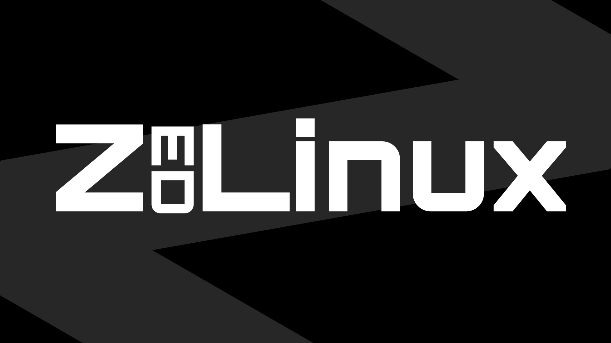

# ZedLinux



<div align="center">
    <h2><i>This is power, unleashed.</i></h2>
</div>


## What is ZedLinux

ZedLinux (Abbr: ZedOS, Z/L) is an overlay install script that transforms a
pre-installed Debian system into a powerful server or workstation operating
system. Rather than shipping a new distro image, ZedLinux layers a curated
toolkit, configuration set, and rebranding on top of a stock Debian base.

## Features

- Python 3 (pip, venv, PyQt5, Tkinter, Pillow)
- C / C++ (GCC, Clang, LLDB, GDB)
- COBOL (GnuCOBOL 4)
- Fortran (GFortran)
- Pascal (Free Pascal + Lazarus IDE)
- Build tooling (Make, CMake, Ninja, Autoconf, Automake, Bison, Flex)
- Scientific/math libraries (NumPy, SciPy, Pandas, Matplotlib, BLAS, LAPACK, FFTW3, GMP, MPFR, Boost)
- Qt5 & GTK3 development libraries
- XFCE Desktop Environment
- Firefox ESR
- VLC / mpv
- GParted & GNOME Disk Utility
- Timeshift system snapshots
- xrdp (RDP access)
- TigerVNC
- Remmina remote desktop client
- Cockpit web admin console
- Optional read-only ZedLinux remote management panel
- KVM, QEMU, Virt-Manager, Docker, libvirt
- MVS TK5 mainframe emulator
- x3270 / c3270 terminal emulators
- Nmap, Masscan, arp-scan, Netdiscover
- iperf3, mtr, traceroute, ethtool
- Bandwidth monitoring utilities (iftop, nload, bmon, vnstat)
- System monitoring and diagnostic utilities
- UFW firewall
- fail2ban intrusion prevention
- OpenSSH client & server
- Various system utilities and enhancements

## Requirements

- A fresh or existing Debian installation (bare metal, VM, or container)
- Root access
- Internet connectivity for package downloads
- Recommended: 10GB+ RAM for full desktop + SDK + virtualization installs

## Installation

```bash
apt install -y git
git clone https://github.com/4248-systems/zedlinux.git
cd zedlinux/src
bash install.sh
```

For lazy people here is the one line command
```bash
apt install -y git && git clone https://github.com/4248-systems/zedlinux.git && cd zedlinux/src && sudo bash install.sh && cd ../.. && rm -rf zedlinux
```

By default, the installer runs interactively and prompts you for each
optional component. To skip prompts, use `-y` / `--unattended` with flags
or environment variables.

## Install Options

| Flag              | Description                                             | Default |
|--------------------|----------------------------------------------------------|---------|
| `-y`, `--unattended` | Skip all prompts; use flags/env vars or defaults        | —       |
| `--ssh=yes\|no`      | Allow SSH through the firewall                          | yes     |
| `--desktop=yes\|no`  | Install the XFCE desktop environment                     | no      |
| `--rdp=yes\|no`      | Install xrdp (requires `--desktop=yes`)                  | no      |
| `--vnc=yes\|no`      | Install TigerVNC (requires `--desktop=yes`)               | no      |
| `--cockpit=yes\|no`  | Install the Cockpit web console                          | no      |
| `--sdk=yes\|no`      | Install COBOL/Fortran/Pascal/C/C++ SDKs                   | no      |
| `--force-fresh`      | Run a full reinstall even if ZedLinux is already present | —       |
| `-h`, `--help`       | Show usage                                               | —       |

Each flag also has a matching environment variable (`ZLINUX_SSH`,
`ZLINUX_DESKTOP`, `ZLINUX_RDP`, `ZLINUX_VNC`, `ZLINUX_COCKPIT`,
`ZLINUX_SDK`) used whenever the flag isn't set.

### Example: unattended server install with SSH only

```bash
sudo ./install.sh -y --ssh=yes --desktop=no
```

### Example: full workstation install

```bash
sudo ./install.sh -y --desktop=yes --rdp=yes --sdk=yes
```

## Updating

Running the installer again on a system where ZedLinux is already present
will refresh packages and re-sync the configuration overlay instead of
doing a full reinstall:

```bash
sudo ./install.sh
```

Use `--force-fresh` to force a complete reinstall instead.

## License

ZedLinux COMES WITHOUT ANY WARRANTY, LIABILITY, OR GUARANTEE OF ANY KIND. USE AT YOUR OWN 
RISK. ZedLinux IS PROVIDED "AS IS" AND "AS AVAILABLE" WITHOUT ANY EXPRESS OR IMPLIED 
WARRANTIES, INCLUDING BUT NOT LIMITED TO THE IMPLIED WARRANTIES OF MERCHANTABILITY, 
FITNESS FOR A PARTICULAR PURPOSE, AND NON-INFRINGEMENT.

ZedLinux is a free and open-source software that can be redistributed and modified under 
the terms of the GNU General Public License (GPL) version 3 or later. By using ZedLinux, 
you agree to comply with the terms of the GPL and any other applicable licenses.

Copyright (C) 2026 4248 Systems, a part of 0x4248. GNU GPL v3

Linux is a registered trademark in the United States and other countries.


## Legal disclaimer

ZedLinux is a community overlay project and is not affiliated with,
endorsed by, or derived from Debian, IBM or any other trademark holder. 

I do not make any profit from this project.

All trademarks mentioned herein are the property of their respective owners.